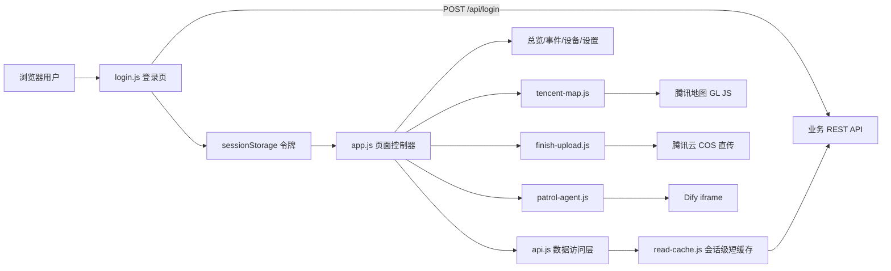

# 智巡云 Web 端技术栈与实现方法说明

## 一、项目定位

本项目是“智巡云·路网健康巡检系统”的 PC 管理后台，面向交通事件、路网巡检、工单处置、车载设备运维和智能问答等场景。系统把前端采集到的告警、地图位置、设备状态和处置结果集中到一个工作台中，形成“发现事件—审核研判—派发工单—上传处理材料—回查结果”的业务闭环。

## 二、150 字左右的技术栈与实现方法总结

**摘要（约 150 字）：**本项目采用原生 HTML5、CSS3 与 JavaScript ES Modules 构建，无前端框架依赖；以 REST API 统一获取告警、工单和设备数据，通过 `sessionStorage` 保存登录态、短缓存与轮询保障实时性。腾讯地图 GL JS 实现点位聚合和人员定位，工单支持审核、派发、催办及图片视频直传腾讯云 COS，Dify iframe 提供智能助手，Node/Nginx 完成部署发布。

### 1. 前端基础

采用原生 HTML5、CSS3 和 JavaScript ES Modules，无前端框架和打包依赖，按功能拆分登录、看板、地图、设备、工单等模块。

**截图建议：**登录页和进入系统后的整体首页，展示页面结构、侧边导航和深色驾驶舱视觉风格。

### 2. 数据与权限

通过 `api.js` 统一封装 REST API，登录令牌写入 `sessionStorage`，数据经过字段映射、短时缓存和失效刷新后供各页面使用。

**截图建议：**浏览器开发者工具 Network 面板中 `/api/login`、`/api/events` 或 `/api/devices` 请求及响应。

### 3. 业务闭环

总览展示告警、工单和设备指标；事件中心支持筛选、审核、派发、催办和处理状态跟踪，操作结果回写后端并刷新相关视图。

**截图建议：**事件中心左侧处置队列、右侧工单详情，以及“发送工单/审核/催办”后的状态变化。

### 4. 空间可视化

接入腾讯地图 GL JS，绘制告警点、聚合点、巡检路线和人员位置，并按优先级、事件类别和坐标有效性进行展示与筛选。

**截图建议：**地图巡检页，包含底图、红黄告警点、聚合点、右侧图层筛选和人员定位标记。

### 5. 材料上传

工单处理页支持多选图片和视频，浏览器校验大小与格式，PNG/WEBP 转 JPG 后直传腾讯云 COS，逐项显示进度，失败项可重试。

**截图建议：**工单详情的材料上传区域，展示文件队列、进度条、成功提示和失败重试状态。

### 6. 智能助手与部署

左上角通过 Dify iframe 延迟加载 PatrolCloud 智巡助手；网页资源可直接运行，也可由 Node 静态服务和 Nginx 发布，构建产物输出到 `web-dist/`。

**截图建议：**展开后的智巡助手浮窗，以及服务器 Nginx/Dify 反向代理配置或 `web-dist` 发布目录。

## 三、技术栈明细

| 层次 | 技术/组件 | 用途 |
|---|---|---|
| 页面结构 | HTML5 | 页面骨架、语义化区域、表单和无障碍属性 |
| 样式 | CSS3 | 深色驾驶舱布局、响应式面板、动画、状态色和组件样式 |
| 业务逻辑 | 原生 JavaScript ES Modules | 页面导航、状态管理、事件绑定、数据渲染和交互控制 |
| 接口通信 | Fetch API、XMLHttpRequest | REST 请求、登录、查询、写入和上传进度回调 |
| 地图 | 腾讯地图 GL JS、MarkerCluster | 底图、告警点、聚合、路线、人员定位和逆地址解析 |
| 文件存储 | 腾讯云 COS | 工单处理图片/视频的浏览器直传和临时预览 |
| AI 能力 | Dify 嵌入式 Chat/Chatbot iframe | PatrolCloud 智能问答入口 |
| 服务与发布 | Node.js 原生 HTTP、Nginx | 静态资源服务、可选上传服务、反向代理和生产发布 |
| 构建 | Node.js `scripts/build-web.mjs` | 清理并复制网页资源到 `web-dist/` |
| 数据模型 | `web/js/types.js` 与 `api.js` 映射函数 | 统一告警、设备、工单等前端对象结构 |

## 四、总体架构与数据流



核心原则是“页面只处理展示和交互，接口细节集中在数据访问层”。`api.js` 将后端字段转换为前端统一模型，页面模块不直接拼接数据库字段；写操作完成后主动让相关缓存失效，避免旧数据覆盖刚提交的结果。

## 五、主要实现方法

### 5.1 启动与登录

1. `index.html` 只加载基础样式和 `login.js`。
2. `login.js` 渲染登录窗口，对账号格式和空密码进行前置校验。
3. 登录成功后保存 `token`、账号、姓名和部门到 `sessionStorage['traffic-auth']`。
4. 登录层移除后动态加载 `app.js`，避免未登录用户提前访问业务页面。
5. 退出登录时清除会话并重新加载页面。

这种方式把“认证前页面”和“业务页面”隔离，刷新页面后仍可依据当前会话恢复用户信息。

### 5.2 数据访问、映射与缓存

`api.js` 统一处理请求地址、认证头、超时、JSON 解析和错误状态。真实环境通过 `web/js/config.js` 中的 `baseUrl` 访问后端，`useMock` 只作为离线演示兜底。

后端数据可能存在历史字段和状态编码，例如 `process_status` 的 `0/1`、中文状态和不同命名的经纬度字段。`mapDatabaseEvent`、`mapDatabaseAlert` 等函数在接口边界完成转换，页面内部只使用统一的 `status`、`priority`、`latitude`、`longitude`、`processedMedia` 等字段。

`read-cache.js` 提供会话级短缓存：相同请求复用进行中的 Promise，默认短时间复用结果；登录状态变化时清空缓存；写请求完成后按资源类型失效缓存。这样可以减少重复读取，也能避免异步返回顺序造成的旧数据覆盖。

### 5.3 总览与实时刷新

`app.js` 维护当前页面、导航编号和数据版本。总览页并行读取 dashboard、alerts、orders、devices 四类数据，计算今日告警、有效率、工单处理率、设备在线率等指标。

总览页每 10 秒进行一次原位刷新，设备页每 5 秒刷新一次；刷新前记录导航编号和数据版本，响应返回后再次比对，页面已经切换或数据已被新操作修改时直接丢弃旧响应。图表和设备状态组件通过 `update()` 更新，尽量保留滚动位置和当前交互状态。

### 5.4 事件与工单闭环

事件中心由 `order-center.js` 负责队列、筛选和详情区域。队列支持关键词、日期、优先级、状态和排序；高优先级事件在列表中突出显示，详情页提供审核、发送工单、催办、处理材料和状态时间线。

写操作通过 `api.js` 的表单请求或 REST 请求完成，并把动作时间追加到备注字段，便于后续追踪。详情操作进行中时禁止切换页面；分配信息通过 `order-assignment-sync.js` 定时读取，页面不可见时暂停刷新，回到前台立即补读。

### 5.5 地图与空间信息

`tencent-map.js` 按需加载腾讯地图 SDK。初始化前过滤无效经纬度；单点按高/普通优先级使用不同图标，多点由 `MarkerCluster` 聚合。点击聚合点放大地图，点击单点回调事件详情。

地图还单独维护人员图层，避免被告警分类筛选影响。逆地址解析使用 JSONP，并以坐标为键缓存结果、合并同一坐标的并发请求；遇到额度限制时设置冷却时间并给出明确提示。

### 5.6 工单材料上传

上传流程在浏览器端完成：

1. 限制每批最多 10 个文件、单文件不超过 200 MB。
2. 检查扩展名、MIME 类型和空文件。
3. PNG/WEBP 用 `createImageBitmap + canvas` 转为白底 JPG；视频统一为 MP4。
4. 生成 UUID，按照 `/工单编号.UUID.jpg|mp4` 生成 COS 对象键。
5. 用 `XMLHttpRequest` 监听上传进度，逐文件串行上传。
6. 成功后立即显示临时预览，失败项保留在队列中，可单独重试。

数据库不直接保存浏览器文件内容，原有扫描任务会按对象键同步处理材料。生产部署需在 COS 配置网页来源的 `PUT` CORS，并保证临时凭证或直传配置不暴露长期密钥。

项目还保留 `server/web-finish-server.mjs` 作为可选的 Node 上传服务：它负责来源校验、Bearer 校验、大小和文件头验证、并发限制及临时文件清理。当前网页主流程按 README 使用 COS 直传。

### 5.7 Dify 智能助手

`patrol-agent.js` 只在用户点击助手时创建 iframe，避免首屏加载 AI 服务。组件支持拖拽、缩放、关闭、重试、独立窗口打开和键盘 Esc 关闭；跨域 iframe 无法被前端读取业务健康状态，因此只把“页面已加载”作为连接提示，不伪造后端在线状态。

部署时使用 Dify 发布的 `/chat/分享码` 或 `/chatbot/分享码` 地址，不在前端放 API Key。若通过同一域名部署，Nginx 必须将 `/chatbot/`、`/embed.min.js` 等路径优先转发到 Dify 服务，避免回退到驾驶舱首页。

## 六、实践中解决问题的方法

| 问题 | 处理方法 | 结果 |
|---|---|---|
| 后端字段和前端展示不一致 | 在 `api.js` 边界做字段映射和状态归一化 | 页面组件保持简单，兼容历史接口 |
| 高频刷新导致旧响应覆盖新操作 | 缓存去重、写后失效、导航编号/数据版本校验 | 降低竞态和脏数据风险 |
| 地图点位重叠、人员与告警混杂 | 告警使用聚合图层，人员使用独立图层 | 大量点位仍可读，筛选互不干扰 |
| 坐标缺失或超范围 | 绘制前统一校验经纬度，缺失时显示降级状态 | 避免地图初始化异常 |
| 图片格式和上传失败 | 前端转码、大小限制、逐项进度、失败重试 | 降低用户重复操作成本 |
| 跨域 iframe 无法判断服务健康 | 只检测加载、提供重试和独立窗口，并在服务端修正 Nginx 分流 | 连接提示更符合实际情况 |
| 页面切换时异步任务未结束 | 控制器销毁、AbortController、忙碌状态拦截 | 防止事件监听和定时器泄漏 |

## 七、部署与运行路线

### 本地预览

```powershell
npx serve web
```

也可以使用项目提供的 Node 服务：

```powershell
npm run start:web
```

### 生产构建

```powershell
npm run build:web
```

构建脚本清理并复制 `web/` 到 `web-dist/`，包含 HTML、CSS、JS 和图片资源。部署时需要一并带上本机生成且被 Git 忽略的 `web/js/cos-direct-config.js`（若启用 COS 直传配置）。

### 上线检查

1. `web/js/config.js` 的 `baseUrl` 指向真实 API，`useMock` 设为 `false`。
2. 腾讯地图 Web Key 配置域名白名单，确认后端坐标为 GCJ-02。
3. COS 配置网页来源 CORS、直传权限和对象生命周期策略。
4. Dify 配置 `ALLOW_EMBED`、HTTPS、反向代理和 WebSocket。
5. Nginx 配置静态站点、API 代理、Dify 路由和可选上传服务。
6. 使用真实账号登录，依次验证总览、事件审核、工单派发、材料上传、地图点位和智能助手。

## 八、截图采集清单

| 编号 | 截图位置 | 用途 |
|---|---|---|
| 1 | 登录页 | 说明认证入口和系统品牌 |
| 2 | 路网总览首页 | 展示指标卡、趋势图、设备状态和告警概览 |
| 3 | 事件中心 | 展示队列筛选、工单详情和操作闭环 |
| 4 | 地图巡检 | 展示腾讯地图、点位聚合、路线和人员图层 |
| 5 | 设备中心 | 展示设备健康分布、状态明细和设备列表 |
| 6 | 处理材料上传 | 展示文件队列、进度条、成功/失败重试 |
| 7 | 智巡助手浮窗 | 展示 Dify iframe 的交互入口 |
| 8 | Network 请求或部署目录 | 作为技术实现证据，展示 API、COS 或 `web-dist` |

## 九、支撑代码索引

- 页面入口：[web/index.html](web/index.html)
- 应用控制器：[web/js/app.js](web/js/app.js)
- 接口与数据映射：[web/js/api.js](web/js/api.js)
- 登录流程：[web/js/login.js](web/js/login.js)
- 缓存实现：[web/js/read-cache.js](web/js/read-cache.js)
- 腾讯地图：[web/js/tencent-map.js](web/js/tencent-map.js)
- 工单中心：[web/js/order-center.js](web/js/order-center.js)
- 材料上传：[web/js/finish-upload.js](web/js/finish-upload.js)
- COS 直传：[web/js/cos-direct.js](web/js/cos-direct.js)
- Dify 助手：[web/js/patrol-agent.js](web/js/patrol-agent.js)
- 构建脚本：[scripts/build-web.mjs](scripts/build-web.mjs)
- 可选 Node 服务：[server/web-finish-server.mjs](server/web-finish-server.mjs)
- 地图配置说明：[TENCENT_MAP_SETUP.md](TENCENT_MAP_SETUP.md)
- Dify 部署说明：[deploy/dify/README.md](deploy/dify/README.md)

## 十、结论

该 Web 端采用轻量、可直接部署的原生前端方案，把实时数据展示、地图空间分析、工单流转、云存储上传和 AI 助手整合到统一驾驶舱。实现重点不在引入大型框架，而在接口边界治理、异步状态控制、异常降级和部署链路完整性，适合在已有 REST API 和基础设施上快速落地并持续迭代。
